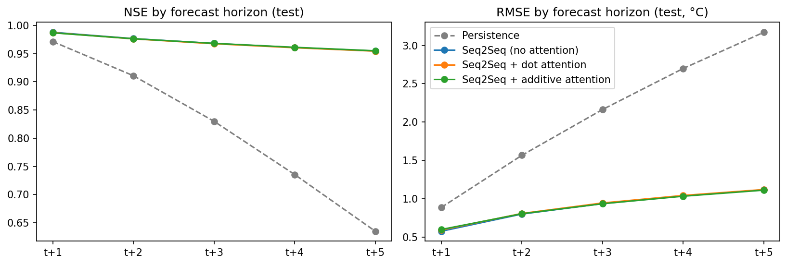
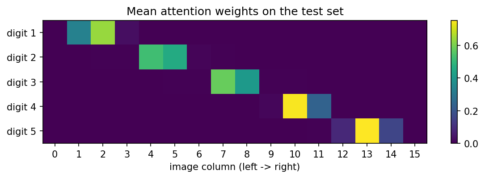

# Hanoi Temperature Forecasting and Electricity Meter Reading

Final project for Deep Learning at the National Economics University (NEU), instructor Dr. Nguyễn Thị Kim Ngân.

Group 9: Triệu Hải Đăng Trình, Trương Hoàng Tùng, Nguyễn Đại Quân, Nguyễn Dương Hiếu.

Everything on this project is built with TensorFlow/Keras and the methods of the course (LSTM, encoder-decoder, attention, CNN):

- **Task 2** - forecast the air temperature in Hanoi for the **next 5 hours** (t+1 ... t+5) with an encoder-decoder LSTM + attention.
- **Task 3** - read the 5-digit value of an **electricity meter** from a photo with a CNN encoder + LSTM decoder + attention.

Both tasks are evaluated with R², NSE, MAE and RMSE. Following the lecturer's slide (Chapter 2.1), R² is the squared Pearson correlation between observed and predicted values and NSE = 1 - SSE/SST (`sklearn.metrics.r2_score` gives NSE, not this R²). See `src/metrics.py`.

## Data

- **Task 2:** hourly weather for central Hanoi from the [Open-Meteo Historical Weather API](https://open-meteo.com/en/docs/historical-weather-api) (ERA5 reanalysis, CC BY 4.0), 2016-01-01 to 2025-12-31: 87,672 hours, 8 variables (temperature, humidity, dew point, pressure, precipitation, cloud cover, wind speed, wind direction), no missing values. Split by time: 70 % train / 15 % validation / 15 % test. Details in `data/README.md`.
- **Task 3:** [UFPR-AMR](https://web.inf.ufpr.br/vri/databases/ufpr-amr/) (Laroca et al., 2019) - 2,000 photos of electricity meters, each with a 5-digit reading; official split 800 train / 400 validation / 800 test. Available on request for academic use only, so it is not stored in this repository.

## Results

### Task 2 - temperature forecast for the next 5 hours (test set, 2024-07-02 to 2025-12-31)

Over all five hours:

| Model | R² | NSE | MAE (°C) | RMSE (°C) |
|---|---|---|---|---|
| Persistence (forecast = current temperature) | 0.825 | 0.817 | 1.631 | 2.248 |
| Seq2Seq LSTM, no attention | 0.970 | 0.970 | 0.641 | 0.914 |
| Seq2Seq LSTM + dot attention | 0.969 | 0.969 | 0.652 | 0.921 |
| **Seq2Seq LSTM + additive attention** (main model, chosen on validation) | **0.970** | **0.970** | **0.648** | **0.915** |

By horizon (main model vs persistence): NSE 0.987 vs 0.971 at t+1, 0.976 vs 0.911 at t+2, 0.955 vs 0.635 at t+5; RMSE 0.60 vs 0.89 °C at t+1 and 1.11 vs 3.17 °C at t+5.



The encoder-decoder models cut the error of the persistence baseline by about 60 %, and the gap widens with the horizon. Attention brings no measurable gain on this data: its weights stay close to uniform over the 24 input hours (the dot attention favours the latest hours for t+1 and the same hour of the previous day for t+5), because the final encoder state already summarises the day well.

### Task 3 - electricity meter reading (test set, 800 meters)

| Model | Digit accuracy | Reading accuracy (all 5 digits right) | R² | NSE | MAE (kWh) | RMSE (kWh) |
|---|---|---|---|---|---|---|
| CNN trained from scratch + LSTM + attention | 27.8 % | 0.8 % | 0.064 | -0.046 | 9,927 | 17,621 |
| MobileNetV2 + LSTM, no attention | 76.9 % | 29.6 % | 0.504 | 0.477 | 3,576 | 12,456 |
| **MobileNetV2 + LSTM + attention** (main model, chosen on validation) | **94.3 %** | **79.9 %** | **0.841** | **0.831** | **1,152** | **7,078** |

R², NSE, MAE and RMSE are computed on the reading value in kWh. The main model reads 639 of the 800 meters exactly; the median absolute error is 0 kWh, and MAE/RMSE are dominated by a few wrong leading digits (54 readings off by 1,000 kWh or more, while 58 of the 161 wrong readings differ only in the last digit).



- **Transfer learning is necessary:** a CNN trained from scratch on 800 images stays at the accuracy of always guessing the most frequent digit; a MobileNetV2 pretrained on ImageNet (cut at `block_13_expand_relu`, frozen first, then fine-tuned) learns the task.
- **Attention matters here, unlike in Task 2:** it raises exact readings from 29.6 % to 79.9 %. Each digit attends to its own columns of the image (columns 2, 4, 7, 10, 13 for digits 1-5), although the labels never give the digit positions.
- Remaining errors come from blur, reflections, scratches and wheels caught between two values; the last digit is the hardest (89.4 % vs 94.6-96.8 % for the others).

## Repository

```text
notebooks/
  01_forecast_data_preparation.ipynb   Task 2: download, checks, features, EDA, chronological split, windows, persistence baseline
  02_forecast_seq2seq_attention.ipynb  Task 2: encoder-decoder LSTM without attention / with dot attention / with additive attention
  03_forecast_evaluation.ipynb         Task 2: test metrics per horizon, forecast plots, error by hour, attention weights
  04_meter_data_preparation.ipynb      Task 3: annotations, counter crops, digit statistics, augmentation
  05_meter_cnn_lstm_attention.ipynb    Task 3: CNN from scratch vs MobileNetV2 (transfer learning) + BiLSTM encoder + LSTM decoder, without / with attention
  06_meter_evaluation.ipynb            Task 3: test metrics (digit / full-reading accuracy, R², NSE, MAE, RMSE), errors, attention maps
src/
  config.py         paths and settings of both tasks
  weather_data.py   Task 2 data: download, features, chronological split, scaling, sliding windows
  meter_data.py     Task 3 data: annotations from the zip, counter crops (64 x 256), cache, augmentation
  metrics.py        R² (squared Pearson), NSE, MAE, RMSE, per-horizon table (Task 2), digit / reading accuracy (Task 3)
  training.py       callbacks, training history, learning curves, experiment log (both tasks)
data/             Hanoi weather CSV and data notes (UFPR-AMR goes to data/raw/, not committed)
figures/, reports/  results written by the notebooks
```

## How to run

Python 3.10-3.12 with TensorFlow 2.20 (TensorFlow has no wheels for Python 3.14). The notebooks were run in the Anaconda base environment listed in `requirements.txt`.

```bash
pip install -r requirements.txt
```

Run the notebooks in order (VS Code or Jupyter, kernel = the Python 3.12 environment). Notebook 01 downloads the weather data if `data/hanoi_weather_hourly_2016_2025.csv` is missing. For Task 3, put the UFPR-AMR archive received by e-mail at `data/raw/UFPR-AMR.zip` (it is read without unzipping); notebook 04 creates the cropped images in `data/raw/`. The model notebooks have a `TRAIN` switch at the top (in notebook 05 one switch per model): `True` trains from scratch, `False` loads the saved models from `models/`. The trained weights are not in the repository, so the notebooks are saved with their outputs. Training times on a CPU: about 25 minutes per Task 2 model, 20-35 minutes per Task 3 model.
